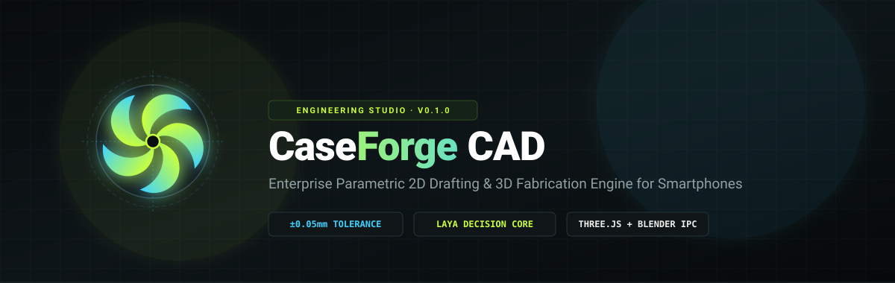
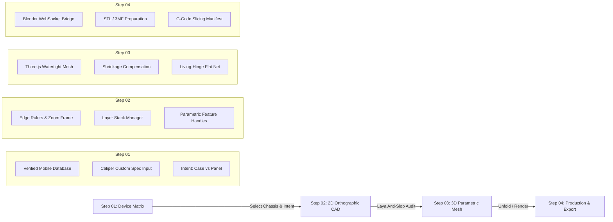

<div align="center">

  

  <br/><br/>

  [](https://github.com/dr-week/Phone-case-maker-2D-3D/releases)
  [](https://github.com/dr-week/Phone-case-maker-2D-3D/actions)
  [](https://www.typescriptlang.org/)
  [](https://threejs.org/)
  [](LICENSE)

  <p align="center">
    <b>Enterprise-grade parametric Computer-Aided Design (CAD) & fabrication suite for next-generation smartphone protective cases and flush replacement backplates.</b>
  </p>

  <p align="center">
    <a href="#-overview">Overview</a> •
    <a href="#-key-architectural-pillars">Pillars</a> •
    <a href="#-workflow-architecture">Workflow</a> •
    <a href="#-core-modules">Modules</a> •
    <a href="#-device-database--calibration">Device Matrix</a> •
    <a href="#-getting-started">Quickstart</a> •
    <a href="#-3d-printing--manufacturing-specs">Manufacturing</a> •
    <a href="#-license">License</a>
  </p>

</div>

---

## 🧭 Overview

**CaseForge CAD** is an industrial-standard engineering design application created to bridge the precision gap between 2D orthographic drafting and 3D additive/subtractive manufacturing for mobile devices.

Whether drafting **high-impact protective bumper cases** (with peripheral button pass-throughs and screen retention lips) or **flush replacement backplates** (zero side wrap for glass/composite adhesive mounting), CaseForge guarantees sub-millimeter geometric accuracy through deterministic verification engines and living-hinge folding mechanics.

---

## ⚡ Key Architectural Pillars

<table>
  <tr>
    <td width="50%" valign="top">
      <h3>🛡️ Dual Design Intent Architecture</h3>
      <ul>
        <li><b>Back Case (Protective Shell)</b>: Extrudes 3D perimeter side walls (<code>phone thickness + 1.6mm</code>), button key slot pass-throughs, bottom USB-C/speaker ports, and front screen retention lips.</li>
        <li><b>Back Panel (Replacement Backplate)</b>: Flat 0.8–1.2mm precision plate engineered for chassis adhesive frame mounting with camera lens chamfers and zero side wrap.</li>
      </ul>
    </td>
    <td width="50%" valign="top">
      <h3>📐 Photoshop/Canva Edge Rulers & Canvas</h3>
      <ul>
        <li><b>Perimeter Edge Rulers</b>: Continuous top & left millimeter rulers locked to canvas borders with dynamic step subdivision.</li>
        <li><b>Infinite Canvas Navigation</b>: Smooth mouse-centered wheel zoom (30% to 600%), middle-click panning, spacebar pan, and responsive HUD overlay controls.</li>
      </ul>
    </td>
  </tr>
  <tr>
    <td width="50%" valign="top">
      <h3>⚡ Laya Deterministic Decision Core</h3>
      <ul>
        <li><b>Sub-Millisecond Routing</b>: Single-pass, non-autoregressive decision engine routing camera aperture styles and fabrication constraints without LLM token consumption.</li>
        <li><b>Anti-Slop CAD Guard</b>: Strict geometry linter catching non-manifold curvatures, inverted boundaries, and 3D print delamination risks.</li>
      </ul>
    </td>
    <td width="50%" valign="top">
      <h3>🧩 Mesh Generation & Unfolding Engine</h3>
      <ul>
        <li><b>Three.js Parametric Extruder</b>: Real-time manifold mesh generation with filament material shaders (Neon PLA, Carbon Fiber, TPU, Frosted Resin).</li>
        <li><b>Living-Hinge Unfolder</b>: Unfolds complex 3D phone cases into 2D laser-cuttable sheet nets with dashed flex relief slits.</li>
      </ul>
    </td>
  </tr>
</table>

---

## 🔄 Workflow Architecture



---

## 📦 Core Modules

### 1. `features/2d-design`
- **`WorkspaceRulerFrame.tsx`**: High-performance HTML5 canvas ruler frame providing sub-millimeter tick marks, pointer indicator sync, and transformation matrices.
- **`InteractiveBackCoverSvg.tsx`**: Dynamic SVG drafting canvas rendering front orthographic projections, symmetry centerlines, camera islands, lens apertures, and peripheral button cutouts.
- **`CadLayerManager.tsx`**: Professional layer stack orchestrator allowing independent visibility toggles, opacity control, and layer locking.
- **`laya_cad_decision_router.ts`**: Fast typed choice router computing structural feasibilities, tolerance scores, and auto-correction patches.
- **`anti_slop_cad_guard.ts`**: CAD audit rule engine catching geometric anomalies before passing parameters to CSG extrusion.

### 2. `features/3d-engine`
- **`case_geometry_builder.ts`**: Constructive Three.js geometry builder compiling parametric chassis profiles into watertight solid meshes.
- **`flat_pattern_builder.ts`**: Living hinge mathematical generator computing bending allowances, slit widths, and bridge lengths for flat sheet folding.
- **`case_3d_orchestrator.ts`**: Coordinates scene lights, camera positions, materials, and fold animation state machines.

### 3. `features/device-library`
- **`phone_database_india.ts`**: Calibrated specifications for major models (Xiaomi 11i HyperCharge, Samsung Galaxy A73, OnePlus, Apple iPhone, Google Pixel).
- **`online_device_spec_fetcher.ts`**: Normalizer parsing physical dimensions and disassembly replacement backplate availability.

---

## 📱 Device Database & Calibration

All pre-configured devices in CaseForge undergo geometric sanity calibration across:
- **Body Envelope**: Height, width, thickness, and corner radius ($R$).
- **Camera Island**: Millimeter bounding box, relative corner radius, and top/left edge margins.
- **Aperture Offsets**: Center $(x,y)$ coordinates, radii, and thermal contraction compensation (+1.4 to 1.8mm).
- **Side Features**: Left/right volume rockers, power buttons, secondary mic pinholes, and bottom speaker/USB-C channels.

---

## 🚀 Getting Started

### Prerequisites
- **Node.js**: v18.0.0 or higher
- **npm** or **pnpm**
- **Blender 4.x+** *(Optional: For live Blender bridge integration)*

### Setup & Local Execution

1. **Clone the Repository**:
   ```bash
   git clone https://github.com/dr-week/Phone-case-maker-2D-3D.git
   cd Phone-case-maker-2D-3D
   ```

2. **Install Dependencies**:
   ```bash
   npm install
   ```

3. **Launch CAD Studio (Development Mode)**:
   ```bash
   npm run dev
   ```
   Navigate to `http://localhost:5173` in your browser.

4. **Compile Production Bundle**:
   ```bash
   npm run build
   ```

5. **Run Automated Test Suites**:
   ```bash
   npm --prefix mcp-server test
   ```

---

## 🖨️ 3D Printing & Manufacturing Specs

| Specification | Protective Back Case | Replacement Back Panel |
| :--- | :--- | :--- |
| **Target Thickness** | $1.6\text{ mm} - 2.2\text{ mm}$ | $0.8\text{ mm} - 1.2\text{ mm}$ |
| **Material Recommendation** | TPU (95A), PETG, PLA Tough | Resin (SLA), PMMA/PC, Polycarbonate |
| **Infill Percentage** | 100% Solid Perimeter Walls | 100% Solid Uniform Extrusion |
| **Chassis Clearance** | $+0.35\text{ mm}$ | $+0.05\text{ mm}$ (Gasket Flush) |
| **Shrinkage Offset** | $+1.4\text{ mm}$ to $+1.8\text{ mm}$ (Lens R) | Exact Chamfer Profile |
| **Perimeter Side Wrap** | Full side rim + front screen lip | $0\text{ mm}$ (Zero Rim Wrap) |

---

## 👥 Engineering & Contributions

Contributions, bug reports, and device parameter submissions are welcome. Please read our contribution guidelines and submit pull requests following standard Git feature branch workflows.

---

## 📄 License

Distributed under the **MIT License**. See [LICENSE](LICENSE) for more information.

<div align="center">
  <sub>Maintained by <b>dr-week</b> · Built for engineers, industrial designers, and makers worldwide.</sub>
</div>
